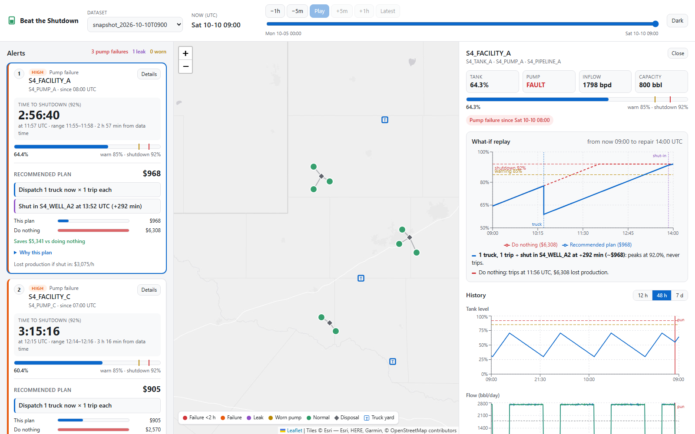

# Beat the Shutdown

Operator console for EOG's "Beat the Shutdown" challenge (HackUTD 2026). It reads water-facility
telemetry, detects **pump failures, pipeline leaks and worn pumps**, counts down to each tank's
shutdown limit, and recommends the cheapest response: trucks, well shut-ins, a mix, or accepting
the trip, with all failures in a system sharing its trucks.


<!-- Screenshot placeholder: save a capture of the console as docs/screenshot.png -->

## What's in it

| Part | What it does |
|---|---|
| `backend/loader.py` | Loads a dataset folder (`network.json`, `ops.json`, `telemetry.csv`). "Now" is the last `ts_unix` |
| `backend/detect.py` | The three detectors, relative to each asset's own healthy baseline and noise |
| `backend/forecast.py` | Tank level and `hours_to_limit` (p10/p50/p90) for ongoing pump failures |
| `backend/optimize.py` | Exhaustive cheapest-plan search per system with a shared truck fleet, plus what-if trajectories |
| `backend/alerts.py` | Alerts ordering (SPEC "Alerts view") and the `events.json` export |
| `backend/api.py` | FastAPI: `/api/datasets`, `/network`, `/alerts`, `/events`, `/series`, `/plan` |
| `frontend/` | React + Vite + TypeScript console with a Leaflet map and Recharts trends |
| `scripts/score.py` | Grades detection, forecasts, plans and alert order against every `answer_key.json` |

`answer_key.json` is only ever read by `scripts/score.py`, never by the app.

## Run it

Requirements: Python 3.13 and Node.js 20 or newer. The challenge data folder `HackUTD-ZeroDay/`
must sit in the project root (or point `BTS_DATA_ROOT` at it).

```bash
# 1. backend
pip install -r requirements.txt
uvicorn backend.api:app --reload            # http://127.0.0.1:8000

# 2. frontend (second terminal)
cd frontend
npm install
npm run dev                                  # http://localhost:5173, proxies /api to :8000
```

Single-port option: run `npm run build` in `frontend/` once. `uvicorn backend.api:app` then also
serves the built console at http://127.0.0.1:8000. To try it from a phone on the same network,
start uvicorn with `--host 0.0.0.0`, or open the Vite dev server's network URL.

Any folder under `HackUTD-ZeroDay/` that holds the three data files shows up in the dataset
switcher, including `test/` once it has been pulled (`git -C HackUTD-ZeroDay pull`).

## Using the console

- **Header:** dataset switcher, the data's "now" (UTC), and a time-travel slider across the dataset.
  Use −1h/−5m/+5m/+1h to step, **Play** to replay forward, and **Latest** to return to the end.
  Every view is recomputed from the data up to the chosen moment.
- **Alerts:** shown in SPEC order. Pump failures come first, soonest to shutdown first (ties go to
  higher lost revenue per hour). Each failure card has a live countdown, a tank gauge, the
  recommended plan with its plain-English reasoning, and its cost against doing nothing. Leaks are
  marked **Urgent**; worn pumps show their confidence. A leak the data can't confirm as still open
  (the pump hasn't run since) is labelled **Unverified**.
- **Map:** systems, facilities (colored by severity), disposal sites (diamonds), truck yards (T)
  and pipelines; a leaking pipeline is drawn dashed. Click a facility to open its detail.
- **Facility detail:** current readings, a what-if replay (tank level under the recommended plan
  vs doing nothing, against the warning and shutdown lines), and tank level, flow and pressure
  history with event onsets marked.
- **Phone:** the same three views as tabs along the bottom. Light and dark themes are available
  from the header button.

Deep links: `?dataset=history/full_week&now=1791460800&facility=S2_FACILITY_A&theme=dark`.

## Live hardware twin

An ESP32 (see `firmware/`) streams one extra facility, `TWIN_FACILITY` in its own system
`TWIN`. Every ~2 s it posts to `POST /twin/ingest`:

```json
{"level_pct": 54.2, "pump_status": 1, "vibration": 0.31, "ts": 1794101999}
```

`pump_status` is 0 stopped, 1 running, 2 fault. `vibration` is the standard deviation of the
acceleration magnitude in g. `ts` is optional: epoch seconds or ms, and anything else (such as
`millis()`) falls back to the server's receive time. The reply carries the pump setpoints so the
device stays in sync.

The twin's tank size, setpoints, wells, prices, repair time and truck fleet come from
`twin_config.json`, at demo scale so a stall plays out in a couple of minutes. The device has no
flow meter, so inflow is estimated from how fast the level rises while the pump isn't running.
The same detection, countdown and planning code then runs on the twin. The console shows it with
a **LIVE** badge: a status strip above the alerts, its alerts merged in SPEC order, a pulsing ring
on the map, and a detail view with a vibration chart.

No hardware? Simulate it, including a pump stall:

```bash
python scripts/fake_twin.py --reset                         # real time, stalls after ~90 s
python scripts/fake_twin.py --reset --stall-after 20        # stall sooner
python scripts/fake_twin.py --url http://<laptop-ip>:8000/twin/ingest
```

Run uvicorn with `--host 0.0.0.0` so the ESP32 can reach the laptop. Use `POST /twin/reset` to
clear the twin's history and `GET /api/twin` to see its status.

## Shift handoff agent (NVIDIA Nemotron)

The **Shift handoff** button in the header writes a handoff for the moment on screen.
`backend/agent.py` is a multi-step, tool-using agent. Each tool calls the existing modules:

| Tool | What it returns |
|---|---|
| `get_alerts` | Every problem in progress in SPEC order with countdown, plan, costs and evidence; plus events resolved in the last 12 h |
| `get_series` | Summary and ~24 points of one telemetry series |
| `optimize_plan` | The cheapest plan from now for a pump failure, with its reasoning |
| `what_if` | Any custom truck or shut-in plan scored against doing nothing |
| `write_handoff` | Saves the final Markdown (also to `handoffs/`, gitignored) |

To turn it on, copy `.env.example` to `.env` and set `NVIDIA_API_KEY` (from build.nvidia.com).
The model defaults to `nvidia/llama-3.3-nemotron-super-49b-v1` and can be changed with
`NVIDIA_MODEL`. The only LLM call is `llm_chat()`. Without a key, or if the call fails for any
reason, the same tools fill a fixed template, so the button always works. The panel shows which
mode was used and the tool calls made. From the command line:
`python -m backend.agent HackUTD-ZeroDay/history/snapshot_2026-10-10T0900`.

## Results

Measured with `scripts/score.py` against the practice answer keys (never read by the app).

| Check | Result |
|---|---|
| Detection, `full_week` and all 3 snapshots | 23/23, 13/13, 15/15, 21/21 events; 0 missed, 0 false |
| Onset error | mean 2.8–5.4 min per folder, worst 25 min |
| 15-minute sweep of `full_week` (624 cuts, each treated as "now") | 0 missed, 0 false, 0 wrong status; onset error mean 4.6 min, p95 20 min |
| Plans vs `reference_action` | 13/13 at each onset (`full_week`), 7/7 from "now" (snapshots) |
| `hours_to_limit` vs reference (snapshots) | within 0.8 min |

### How fast each fault is flagged

From the 15-minute sweep. A fault counts as flagged at the first reading that tripped the
detector, using only data up to that moment, measured from the answer key's true onset.

| Fault | Events | Flagged after onset: median | Worst | After the pump first runs: median | Worst |
|---|---|---|---|---|---|
| Pump failure | 13 | 0 min | 0 min | 0 min | 0 min |
| Pipeline leak | 5 | 30 min | 90 min | 25 min | 30 min |
| Worn pump | 5 | 170 min | 225 min | 55 min | 205 min |

Leaks and worn pumps can only be seen while the pump runs (no flow, no signal), so part of each
lag is time the pump sat idle. EVENT_1's 90 min, for example, is 60 min with the pump off plus
30 min of detection. A worn pump loses only about 0.4 % of its flow per hour, so it takes a few
hours of running to stand clear of the noise. Each leak and wear alert in the console shows
"Detected X after onset". There, onset is the app's own estimate, since the true onset isn't
known live.

Reproduce with `python scripts/score.py --sweep 0.25`.

## Check accuracy

```bash
python scripts/score.py                      # every practice folder: detection, plans, forecasts, order
python scripts/score.py --sweep 1            # also cut full_week every hour and grade each cut
python -m backend.alerts HackUTD-ZeroDay/history/mock_test_2026-10-10T1530 -o events.json --alerts
```
