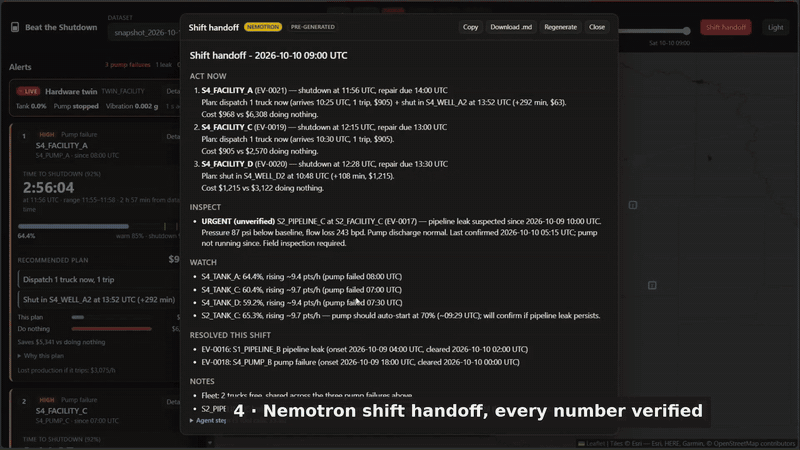

# Beat the Shutdown

A night-shift operator console that catches failing pumps and leaks early, counts down to tank shutdown, and recommends the cheapest way to keep an oil field's water system running.



**HackUTD 2026 — Honorable Mention, EOG Resources track. Solo, 24 hours.**

[Demo video](https://youtu.be/Ic_n8HU9wjk) · [Full documentation](docs/DETAILS.md)

## What it does
Every barrel of oil brings up salt water that is stored in tanks and pumped to disposal sites. When a pump fails, the tank fills and the wells are forced to shut in, losing revenue until the repair. Beat the Shutdown reads raw facility telemetry, detects pump failures, pipeline leaks and worn pumps with a confidence level and plain-English evidence, and predicts the time until each tank hits its shutdown limit. It then searches every combination of trucks, trips and well shut-ins, planning failures in the same system together because they share one truck fleet, and recommends the cheapest response. An NVIDIA Nemotron agent writes the shift handoff, and an ESP32-S3 hardware twin runs a physical "pump" through the same code live.

## Results
- Found 23 of 23 fault events with no false alarms, graded against EOG's answer keys
- Matched all 20 of EOG's reference response plans, every cost within $19
- Cheapest recommended response cut the worst case from $12,000 to $3,088 (74%)
- Pump failures flagged at onset, leaks a median of 30 minutes after onset
- No misses or false alarms when replaying the week every 15 minutes (624 points in time) or with 3% of readings dropped

## How it works
```
ESP32-S3 twin ──► telemetry over Wi-Fi every 2 s ─┐
EOG dataset (network, ops, telemetry) ────────────┴──► FastAPI ──► detection ──► forecast ──► cost optimizer ──► React console
                                                                                                    └──► Nemotron shift handoff
```
- **Detection:** statistics relative to each asset's own healthy baseline and noise. Leaks from flow lost between pump and disposal plus a pipeline pressure deficit; worn pumps from a CUSUM and trend fit on flow ratio.
- **Forecast:** mass balance — room left in the tank ÷ inflow.
- **Optimizer:** exhaustive search over trucks, trips and shut-in timing, priced from EOG's data, with a shared fleet per system.
- **Hardware twin:** an ESP32-S3 reads a water level sensor (the tank), drives a TT motor through an L298N at the same start/stop setpoints (the pump), and detects a stall when an IMU on the motor stops feeling vibration.

## What was hard
- **Stall detection.** Vibration from a toy motor is noisy, so it needed automatic startup calibration (median of quiet vs settled running vibration), two consecutive low readings to confirm, and a 2-second ignore window after the motor starts to stop false positives.
- **The board itself.** ESP32-S3 boot-mode and upload failures, power-on resets, a Serial Monitor that rebooted the board on every command (so the firmware calibrates itself and uses the BOOT button), and loose IMU contacts.
- **Leaks are invisible while a pump is off.** Pipeline readings look the same with or without a leak when nothing flows, so the console marks those alerts "Unverified" instead of guessing.
- **Unseen data.** On EOG's test network, three worn pumps lowered pipeline pressure enough to be flagged as leaks with zero lost flow. The fix is to require real lost flow before calling a leak.

## Running it
```bash
pip install -r requirements.txt
uvicorn backend.api:app --host 0.0.0.0 --port 8000
cd frontend && npm install && npm run dev      # http://localhost:5173
```
Place EOG's `HackUTD-ZeroDay/` data folder in the project root. On Windows, `scripts\start_demo.ps1` starts everything in one command. Firmware setup and wiring are in [`firmware/README.md`](firmware/README.md); run `python scripts/fake_twin.py` to simulate the ESP32. More in [docs/DETAILS.md](docs/DETAILS.md).

## Stack
C++ (Arduino), ESP32-S3, L298N, MPU-6500 IMU, Python, pandas, FastAPI, React, TypeScript, Vite, Leaflet, Recharts, NVIDIA Nemotron
